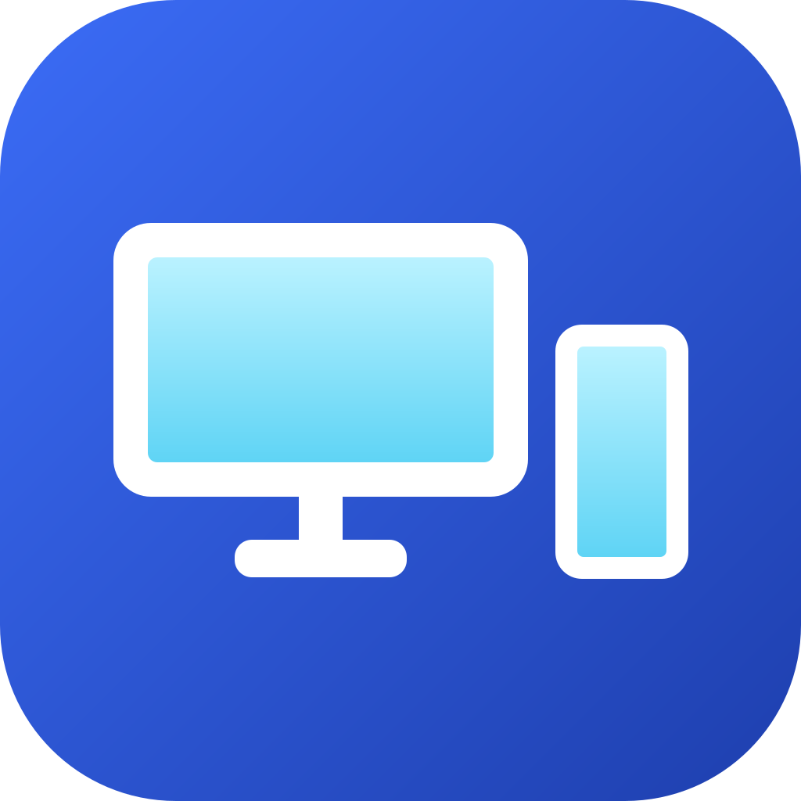

#  EkranLink

[](https://github.com/meg55/EkranLink/actions/workflows/derle.yml)

Eski tablet ve telefonlarınızı bilgisayarınız için ekran yapın: **yansıtma**, **ikinci ekran** veya
**Windows'un tek ekranı** olarak, **USB** ya da **Wi-Fi** ile. Android 4.1'e kadar eski cihazları destekler.

*Turn old tablets and phones into displays for your PC — mirror, extend, or use as the only screen,
over USB or Wi-Fi. Supports devices as old as Android 4.1.*

> **Durum:** yansıtma ve **ikinci ekran** (USB ve şifreli Wi-Fi), dokunmatik fare, otomatik bulma ve kurulum çalışıyor.
> İkinci ekran için sanal ekran sürücüsü şimdilik yalnızca derlendiği bilgisayarda kurulabiliyor ([driver/](driver/README.md)).
> Plan ve ölçümler: [docs/ROADMAP.md](docs/ROADMAP.md) · Test edilen cihazlar: [docs/DEVICES.md](docs/DEVICES.md)

## Neden?

- Mevcut çözümlerin çoğu kapalı kaynak ve Android 5.0+ istiyor; çekmecedeki 4.x tabletler dışarıda kalıyor.
- Hedef, "eski tableti tak, harici monitör olsun" deneyimi: USB'yi takınca Windows'ta yeni bir monitör belirir.

## Depo yapısı

```
android/        Android istemci (Java, minSdk 16)
host-windows/   Windows sunucusu (C++, MinGW ile derlenir)
driver/         Sanal ekran sürücüsü (IddCx, SudoVDA tabanlı, MSVC + WDK ile derlenir; ayrı lisans)
docs/           Yol haritası, protokol, cihaz listesi
tools/          Geliştirme ve ölçüm betikleri
```

## Kullanım

1. `dist\EkranLink-<sürüm>-windows.zip` dosyasını açın, `EkranLink.exe`'yi çalıştırın (kurulum gerekmez).
   Ayar penceresi açılır ve saatin yanında bir monitör simgesi belirir. Pencerenin solundaki menüyle
   sayfalar arasında geçilir: *Durum, Bağlantı, Görüntü, Dokunma ve performans, Genel*. Pencereyi
   kapatmak EkranLink'i kapatmaz; simgeye tıklayınca yeniden açılır (sağ tık: kısa menü, çıkış).
2. Tablet uygulaması ayrı indirilir: `EkranLink-<sürüm>-android.apk` dosyasını tablete kurun (tabletin
   tarayıcısıyla indirip açın ya da USB ile kopyalayıp dosya yöneticisinden açın). PC tablete uygulama
   kurmaz. İki uygulamanın sürümü uyuşmazsa ikisi de hangisinin güncelleneceğini söyler.
   USB ile bağlanmak için tablette *Geliştirici seçenekleri > USB hata ayıklama* açık olmalı.
3. Tablette EkranLink açıkken bilgisayar tableti kendiliğinden bulur (önce USB, yoksa Wi-Fi).
   Wi-Fi ile ilk bağlantıda iki cihazda aynı 6 haneli kod görünür; ikisinde de onaylayın.

Tablet Windows'a çoklu dokunmatik ekran olarak bağlanır: kaydırma, iki parmakla yakınlaştırma, basılı tutunca sağ tık.
Üç parmakla dokunmak ölçümleri gösterir/gizler.

**Ekransız mini PC:** pencerede *Genel > Oturum açılmadan önce başlat* (bir kez yönetici izni ister). EkranLink Windows
hizmeti olarak açılışta başlar; kilit ekranı ve şifre ekranı tablette görünür, tabletten açılır (kilit
perdesini yukarı kaydırın). Windows kilit ekranını yalnızca ana monitörde gösterir.

**Otomatik bağlanma:** PC'de *Bağlantı > Cihaz bulununca otomatik bağlan*, tablette karşılama ekranındaki
*Bilgisayara takılınca otomatik aç*. İkisi de açıksa tableti takmanız yeterli; biri kapalıysa pencerenin
*Durum* sayfasındaki listeden *Bağlan*'a tıklayın ya da tablette EkranLink'i açın.

**Birden çok cihaz:** Birden çok tablet ya da telefon aynı anda bağlanabilir; her biri Windows'ta ayrı bir
monitör olur. *Durum* sayfasında her bağlı cihazın *Bağlantıyı kes* düğmesi, bulunan ama bağlı olmayan
cihazların *Bağlan* düğmesi vardır (sağ tık menüsünde de). Bağlantısını kestiğiniz cihaza, siz yeniden
bağlanana ya da cihaz çıkarılana kadar otomatik bağlanılmaz. Çözünürlük ve son kullanılan yön cihaz başına
hatırlanır.

**Arka plan:** Tabletteki uygulamayı alta alıp başka uygulama kullanabilirsiniz; Windows'taki monitör
kopmaz, dönünce görüntü kaldığı yerden sürer. Bağlantıyı kesmek için bildirimdeki ya da ölçüm kartındaki
(üç parmak) *Bağlantıyı kes*.

Görüntü modları (pencerede *Görüntü*): **İkinci ekran**, **Tek ekran** (tablet bağlıyken diğer monitörler
kapanır, tablet ayrılınca geri gelir) ve **Yansıtma**. Windows ekranı kapatınca tablet de kararır.

**Monitör yönü** (*Görüntü > Monitör yönü*): *Otomatik*te tableti dik çevirmek Windows'taki monitörü de
dikey yapar (tablette *Otomatik döndür* açık olmalı). *Yatay / Dikey / ters* seçilirse tablet ne gösterirse
göstersin o yön kullanılır. Seçim ve Windows ekran ayarlarından yapılan değişiklik hatırlanır; tablet her
bağlanışta aynı yönde açılır.

**Ekran çözünürlüğü** (*Görüntü*): Windows Ayarlar > Ekran'daki listenin aynısı, aynı biçimde
("1600 × 940"); cihazın kendi çözünürlüğü *(Önerilen)* diye işaretlidir. Seçim cihaz başına hatırlanır
(tablet ve telefon ayrı). Windows'tan yapılan değişiklik EkranLink'te de görünür ve kaydedilir.

Ayarlar bağlantıyı koparmadan uygulanır: dokunma, performans, otomatik bağlan, yön, çözünürlük ve ikinci
ekran ↔ tek ekran anında; yansıtma ↔ ikinci ekran ve yansıtılan ekran görüntü yeniden kurularak (tablet
bağlı kalır). Bağlantı yalnızca bağlantı türü şimdiki bağlantıyı dışarıda bırakırsa (ör. USB'deyken
"Sadece Wi-Fi") yeniden kurulur.

**Dil:** Bilgisayarda pencerede *Genel > Dil* (Sistem / Türkçe / English); tablet ve telefonda cihazın
dili kullanılır. Uygulama telefonlarda da çalışır (küçük ekranda düzen sıkışır, gerekirse kayar).

## Derlemek

Gerekenler: JDK 17+ ve Android SDK (Android Studio ile gelir), MinGW-w64 GCC + CMake + Ninja
(`winget install BrechtSanders.WinLibs.POSIX.MSVCRT`). Visual Studio gerekmez.

```powershell
.\tools\paketle.ps1                          # her şeyi derler, testleri çalıştırır, zip üretir
.\host-windows\build.ps1                     # yalnızca Windows tarafı
.\host-windows\build\ekranlink-host.exe          # konsol sürümü, saniyelik ölçümlerle (--usb / --wifi / --ip)
.\host-windows\build\ekranlink-test.exe          # şifreleme test vektörleri (RFC 8439)
```

Tanı için ham akış testi: `.\tools\faz0.ps1` (ffmpeg gerekir).

## Katkı ve güvenlik

Hata bildirimi ve katkı: [CONTRIBUTING.md](CONTRIBUTING.md). Güvenlik açıklarını herkese açık issue yerine
gizli bildirin: [SECURITY.md](SECURITY.md).

## Lisans

EkranLink [GPL-3.0](LICENSE) ile lisanslıdır. Sanal ekran sürücüsü ([driver/](driver/)) ayrı bir programdır;
Microsoft örneğine dayandığı için MS-PL, EkranLink değişiklikleri MIT ile lisanslıdır
([driver/LICENSE](driver/LICENSE)).

## English

EkranLink turns old Android tablets and phones (Android 4.1+) into displays for a Windows PC, over USB or
encrypted Wi-Fi: as a **second screen** (a real virtual monitor, via an IddCx driver), as the **only screen**
(e.g. for a headless mini PC, including the Windows sign-in screen), or as a **mirror**. Touch is sent back
as Windows multi-touch. Several devices can be connected at once, each as its own monitor.

1. Run `EkranLink.exe` from the Windows zip (no install needed). A settings window opens and an icon
   appears in the notification area.
2. Install `EkranLink-<version>-android.apk` on the device (downloaded separately; the PC never installs
   apps on the device). For USB, enable *Developer options > USB debugging*.
3. Open EkranLink on the device; the PC finds it (USB first, then Wi-Fi). On the first Wi-Fi connection,
   confirm the same 6-digit code on both sides.

The user interface is available in English and Turkish; most documentation is currently in Turkish.
Building: see *Derlemek* above (JDK 17+, Android SDK, MinGW-w64 GCC, CMake, Ninja). License: GPL-3.0; the
driver in `driver/` is MS-PL / MIT.
