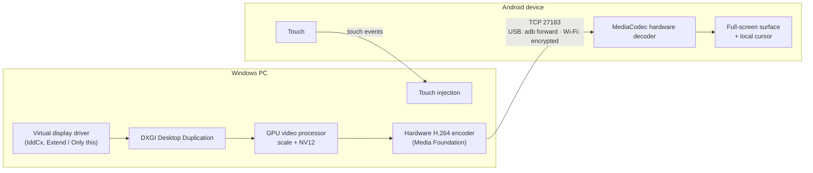
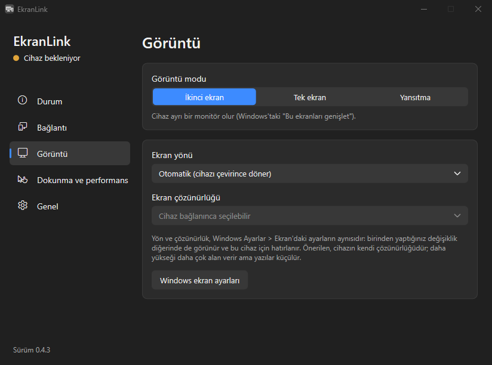
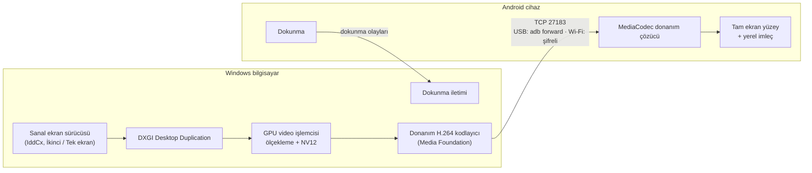

<p align="center">
  
</p>

<h1 align="center">EkranLink</h1>

<p align="center">
  <b>Use your Android tablet or phone as a monitor for your Windows PC — over USB or Wi-Fi.</b><br>
  <b>Android tabletinizi ya da telefonunuzu Windows bilgisayarınızın ekranı yapın — USB ya da Wi-Fi ile.</b>
</p>

<p align="center">
  <a href="https://github.com/meg55/EkranLink/actions/workflows/derle.yml"></a>
  <a href="LICENSE"></a>
  
  
</p>

<p align="center">Click a language to open or close it. · Açmak ya da kapatmak için dile tıklayın.</p>

<details open>
<summary><b>English</b></summary>

<p align="center">
  
</p>

EkranLink turns an Android tablet or phone into a real monitor for a Windows PC. With the virtual display
driver, Windows sees an ordinary monitor at the device's native resolution: you can drag windows onto it,
rotate it and set its resolution in Windows Settings. Touch on the device works like a Windows touch
screen.

It works with current tablets and phones and with devices as old as Android 4.1. No account, no
internet connection, no ads, nothing to configure on most setups.

## Features

- **Three display modes:** *Extend* (a separate monitor), *Only this* (the device becomes the PC's only
  screen and the other monitors turn off while it is connected, handy for a headless mini PC) and *Mirror*.
- **USB or Wi-Fi.** Devices are found automatically. Connections are encrypted (ECDH P-256 +
  ChaCha20-Poly1305); a new device is confirmed once with the same 6-digit code on both screens.
- **Touch:** real Windows multi-touch (up to 10 fingers: scroll, pinch to zoom, press and hold for right
  click, touch keyboard) or a simple mouse mode.
- **Several devices at once,** each as its own monitor. Connect or disconnect each one from the window or
  the tray menu.
- **Follows the device:** turn the tablet upright and the Windows monitor turns portrait. Resolution and
  orientation are remembered per device.
- **Sign-in screen:** optionally runs as a Windows service, so the lock screen, sign-in screen and UAC
  prompts appear on the device too.
- **Light on the system:** the picture never leaves the GPU on the PC (capture, scaling, hardware H.264
  encoding); nothing is sent while the screen is still; the mouse cursor is drawn on the device. Idle CPU use is
  practically zero.
- **Low latency:** about 20–40 ms from PC to screen over USB, measured on a 2013 tablet
  ([measurements](docs/ROADMAP.md)).
- **Bilingual:** English and Turkish user interface.

## Status

| | |
|---|---|
| Mirror, extend, only-this-screen, USB, Wi-Fi, touch, several devices, service mode | Working |
| Windows installer and portable zip | Working; first public release in preparation |
| Virtual display driver (needed for *Extend* and *Only this*) | Working, but **not yet code-signed** for distribution: for now it can only be installed by building it yourself ([driver/](driver/README.md)). Without the driver, EkranLink mirrors. |
| Android app on Google Play | Planned; meanwhile the APK is a separate download |
| macOS, Linux, iPad | Not yet |

The plan and measurements are in [docs/ROADMAP.md](docs/ROADMAP.md); tested devices in [docs/DEVICES.md](docs/DEVICES.md).

## Getting started

1. **PC:** download `EkranLink-<version>-windows-setup.exe` from [Releases](https://github.com/meg55/EkranLink/releases)
   and install it. To try it without installing, unzip `EkranLink-<version>-windows.zip` and run `EkranLink.exe`.
   A settings window opens and an icon appears next to the clock.
2. **Device:** install `EkranLink-<version>-android.apk` on the tablet or phone (open the download on the
   device, or copy it over USB and open it with a file manager). The PC never installs apps on the device.
   For USB, turn on *Developer options > USB debugging* on the device.
3. **Connect:** open EkranLink on the device. Plug in the USB cable, or join the same Wi-Fi network as the PC.
   The PC finds the device by itself (USB first). The first time, confirm the 6-digit code on both
   screens; a new device on Wi-Fi is connected with *Connect* in the window.

Three-finger tap on the device shows or hides the performance overlay.

## Using EkranLink

**Display modes** (*Display* page): *Extend*, *Only this* (other monitors turn off while the device is
connected and come back when it leaves) and *Mirror*. When Windows turns the screens off, the device
screen goes dark too.

**Orientation and resolution** (*Display* page): with *Automatic*, turning the device upright turns the
Windows monitor portrait (auto-rotate must be on on the device). The resolution list is the same as in
Windows Settings > Display, with the device's own resolution marked *(Recommended)*. Changes made in
either place show up in the other and are remembered per device.

**Connecting automatically:** *Connection > Connect automatically when a device is found* on the PC and
*Open automatically when plugged into a computer* on the device's welcome screen. With both on, plugging
in the device is enough. Otherwise click *Connect* in the *Status* page list, or open EkranLink on the device.

**Several devices:** each connected device has a *Disconnect* button on the *Status* page; devices that
were found but are not connected have *Connect* (also in the tray's right-click menu). A device you
disconnect is not reconnected automatically until you connect it again or unplug it.

**In the background:** you can switch to another app on the device; the Windows monitor stays, and the
picture resumes when you come back. To disconnect from the device, use the notification or the
three-finger overlay.

**Headless mini PC:** *General > Start before sign-in* (asks for administrator permission once). EkranLink
then runs as a Windows service from boot; the lock and sign-in screens appear on the device (swipe up on
the lock screen). Windows shows the lock screen only on the main monitor.

Settings apply without dropping the connection: touch, performance, auto-connect, orientation, resolution
and *Extend ↔ Only this* apply instantly; *Mirror ↔ Extend* rebuilds the picture while the device stays
connected.

**Language:** *General > Language* on the PC (System / Türkçe / English); the device uses its own language.

## FAQ

**Does it only work with old tablets?** No. It works with current Android tablets and phones; support for
devices back to Android 4.1 is a bonus, not a requirement.

**Does it need the internet or an account?** No. Everything stays between your PC and your device. Over
Wi-Fi both must be on the same local network.

**Why Android 4.1?** That is when Android got the hardware video decoder API (MediaCodec) that EkranLink
uses. The app is written without AndroidX so it keeps working there.

**Is it safe?** Every connection uses fresh ECDH keys and authenticated encryption, and a new device is
approved once on both screens with a 6-digit code, over USB too. Over USB the picture to the device is not
encrypted (it stays on the cable, and old tablets would slow down); touch from the device always is. See
[docs/PROTOCOL.md](docs/PROTOCOL.md) and [SECURITY.md](SECURITY.md).

**Can I use an iPad or a Mac?** Not yet. A Windows PC and an Android device are required for now.

## How it works



The PC always opens the connection (USB through `adb forward`, Wi-Fi directly to the device), so the
same code path works on Android 4.x, which has no `adb reverse`. Details: [docs/ARCHITECTURE.md](docs/ARCHITECTURE.md)
and the wire protocol in [docs/PROTOCOL.md](docs/PROTOCOL.md).

## Building from source

Requirements: JDK 17+ and the Android SDK (Android Studio includes both), MinGW-w64 GCC + CMake + Ninja
(`winget install BrechtSanders.WinLibs.POSIX.MSVCRT`), Inno Setup 6 for the installer. Visual Studio is not
needed except for the driver (MSVC + WDK, see [driver/README.md](driver/README.md)).

```powershell
.\tools\paketle.ps1                         # builds everything, runs tests, writes dist\ (setup, zip, apk)
.\host-windows\build.ps1                    # Windows side only
.\host-windows\build\ekranlink-host.exe     # console version with per-second stats (--usb / --wifi / --ip)
.\host-windows\build\ekranlink-test.exe     # encryption test vectors (RFC 8439)
```

Every push is built by [GitHub Actions](.github/workflows/derle.yml).

## Repository layout

```
android/        Android app (Java, minSdk 16, no AndroidX)
host-windows/   Windows app (C++20, MinGW): tray app + settings window, Windows service, console tool, installer
driver/         Virtual display driver (IddCx, based on SudoVDA; MSVC + WDK; separately licensed)
docs/           Architecture, wire protocol, roadmap and measurements, device list
tools/          Packaging, icon generation and measurement scripts
art/            Logo, store graphics, screenshots
```

Documents are in English and Turkish: this page has both, other documents come as `X.md` / `X.tr.md`.
Source comments and log lines are in Turkish; a glossary of the Turkish names used in code is in [AGENTS.md](AGENTS.md).

## Contributing

Bug reports, device test results and pull requests are welcome, in English or Turkish. See
[CONTRIBUTING.md](CONTRIBUTING.md). Please report security issues privately as described in
[SECURITY.md](SECURITY.md). If you use an AI coding assistant, point it to [AGENTS.md](AGENTS.md).

## License

EkranLink is licensed under [GPL-3.0](LICENSE). The virtual display driver in [driver/](driver/) is a
separate program, licensed under MS-PL / MIT ([driver/LICENSE](driver/LICENSE)).

</details>

<details>
<summary><b>Türkçe</b></summary>

<p align="center">
  
</p>

EkranLink, Android tablet ya da telefonu Windows bilgisayar için gerçek bir monitöre dönüştürür. Sanal ekran
sürücüsüyle Windows cihazı, kendi çözünürlüğünde sıradan bir monitör olarak görür: pencereleri üzerine
sürükleyebilir, Windows Ayarlar'dan döndürebilir ve çözünürlüğünü değiştirebilirsiniz. Cihazdaki dokunma,
Windows dokunmatik ekranı gibi çalışır.

Güncel tablet ve telefonlarla da, Android 4.1'e kadar uzanan cihazlarla da çalışır. Hesap, internet
bağlantısı ve reklam yok; çoğu durumda ayar da gerekmez.

## Özellikler

- **Üç görüntü modu:** *İkinci ekran* (ayrı bir monitör), *Tek ekran* (cihaz bağlıyken diğer monitörler
  kapanır, cihaz bilgisayarın tek ekranı olur; ekransız mini PC'ler için) ve *Yansıtma*.
- **USB ya da Wi-Fi.** Cihazlar kendiliğinden bulunur. Bağlantılar şifrelidir (ECDH P-256 +
  ChaCha20-Poly1305); yeni bir cihaz iki ekranda görünen aynı 6 haneli kodla bir kez onaylanır.
- **Dokunma:** gerçek Windows çoklu dokunması (10 parmağa kadar: kaydırma, iki parmakla yakınlaştırma,
  basılı tutunca sağ tık, dokunmatik klavye) ya da basit fare modu.
- **Birden çok cihaz aynı anda,** her biri ayrı bir monitör. Her birini pencereden ya da simge menüsünden
  bağlayıp bağlantısını kesebilirsiniz.
- **Cihazı izler:** tableti dik çevirince Windows'taki monitör de dikey olur. Çözünürlük ve yön cihaz başına
  hatırlanır.
- **Oturum açma ekranı:** isteğe bağlı olarak Windows hizmeti olarak çalışır; kilit ekranı, oturum açma
  ekranı ve UAC pencereleri de cihazda görünür.
- **Sistemi yormaz:** görüntü bilgisayarda GPU'dan hiç çıkmaz (yakalama, ölçekleme, donanım H.264
  kodlama); ekran değişmiyorsa hiçbir şey gönderilmez; fare imleci cihazda çizilir. Boştayken işlemci
  kullanımı neredeyse sıfırdır.
- **Düşük gecikme:** USB'de bilgisayardan ekrana yaklaşık 20–40 ms; 2013 model bir tablette ölçüldü
  ([ölçümler](docs/ROADMAP.tr.md)).
- **İki dil:** Türkçe ve İngilizce arayüz.

## Durum

| | |
|---|---|
| Yansıtma, ikinci ekran, tek ekran, USB, Wi-Fi, dokunma, birden çok cihaz, hizmet modu | Çalışıyor |
| Windows kurulum programı ve taşınabilir zip | Çalışıyor; ilk herkese açık sürüm hazırlanıyor |
| Sanal ekran sürücüsü (*İkinci ekran* ve *Tek ekran* için gerekli) | Çalışıyor, ama dağıtım için **henüz imzalı değil**: şimdilik yalnızca kendiniz derleyerek kurulabiliyor ([driver/](driver/README.tr.md)). Sürücü yoksa EkranLink yansıtır. |
| Google Play'de Android uygulaması | Planlandı; o zamana kadar APK ayrı indirilir |
| macOS, Linux, iPad | Henüz yok |

Plan ve ölçümler: [docs/ROADMAP.tr.md](docs/ROADMAP.tr.md) · Test edilen cihazlar: [docs/DEVICES.md](docs/DEVICES.md)

## Başlarken

1. **Bilgisayar:** [Sürümler](https://github.com/meg55/EkranLink/releases) sayfasından
   `EkranLink-<sürüm>-windows-setup.exe`'yi indirip kurun. Kurmadan denemek için
   `EkranLink-<sürüm>-windows.zip`'i açıp `EkranLink.exe`'yi çalıştırın. Ayar penceresi açılır ve saatin
   yanında bir simge belirir.
2. **Cihaz:** `EkranLink-<sürüm>-android.apk` dosyasını tablete ya da telefona kurun (cihazda indirip açın
   ya da USB ile kopyalayıp dosya yöneticisinden açın). Bilgisayar cihaza uygulama kurmaz. USB için
   cihazda *Geliştirici seçenekleri > USB hata ayıklama* açık olmalı.
3. **Bağlanın:** cihazda EkranLink'i açın. USB kablosunu takın ya da bilgisayarla aynı Wi-Fi ağına bağlanın.
   Bilgisayar cihazı kendiliğinden bulur (önce USB). İlk seferde iki ekranda görünen 6 haneli kodu
   onaylayın; Wi-Fi'deki yeni bir cihaza pencereden *Bağlan* ile bağlanılır.

Cihazda üç parmakla dokunmak ölçüm kartını gösterir ya da gizler.

## Kullanım

**Görüntü modları** (*Görüntü* sayfası): *İkinci ekran*, *Tek ekran* (cihaz bağlıyken diğer monitörler
kapanır, cihaz ayrılınca geri gelir) ve *Yansıtma*. Windows ekranı kapatınca cihazın ekranı da kararır.

**Yön ve çözünürlük** (*Görüntü* sayfası): *Otomatik*te cihazı dik çevirmek Windows'taki monitörü de dikey
yapar (cihazda *Otomatik döndür* açık olmalı). Çözünürlük listesi Windows Ayarlar > Ekran'daki listenin
aynısıdır; cihazın kendi çözünürlüğü *(Önerilen)* diye işaretlidir. İki yerden birinde yapılan değişiklik
diğerinde de görünür ve cihaz başına hatırlanır.

**Otomatik bağlanma:** bilgisayarda *Bağlantı > Cihaz bulununca otomatik bağlan*, cihazın karşılama
ekranında *Bilgisayara takılınca otomatik aç*. İkisi de açıksa cihazı takmanız yeterli; değilse *Durum*
sayfasındaki listeden *Bağlan*'a tıklayın ya da cihazda EkranLink'i açın.

**Birden çok cihaz:** *Durum* sayfasında bağlı her cihazın *Bağlantıyı kes* düğmesi, bulunan ama bağlı
olmayan cihazların *Bağlan* düğmesi vardır (simgenin sağ tık menüsünde de). Bağlantısını kestiğiniz cihaza,
siz yeniden bağlanana ya da cihazı çıkarana kadar otomatik bağlanılmaz.

**Arka plan:** cihazda başka bir uygulamaya geçebilirsiniz; Windows'taki monitör kopmaz, dönünce görüntü
kaldığı yerden sürer. Cihazdan bağlantıyı kesmek için bildirimi ya da üç parmakla açılan ölçüm kartını
kullanın.

**Ekransız mini PC:** *Genel > Oturum açılmadan önce başlat* (bir kez yönetici izni ister). EkranLink
açılışta Windows hizmeti olarak başlar; kilit ve oturum açma ekranları cihazda görünür (kilit perdesini
yukarı kaydırın). Windows kilit ekranını yalnızca ana monitörde gösterir.

Ayarlar bağlantıyı koparmadan uygulanır: dokunma, performans, otomatik bağlanma, yön, çözünürlük ve
*İkinci ekran ↔ Tek ekran* anında; *Yansıtma ↔ İkinci ekran* geçişinde görüntü yeniden kurulur, cihaz bağlı
kalır.

**Dil:** bilgisayarda *Genel > Dil* (Sistem / Türkçe / English); cihaz kendi dilini kullanır.

## Sık sorulanlar

**Yalnızca eski tabletlerle mi çalışır?** Hayır. Güncel Android tablet ve telefonlarla çalışır; Android
4.1'e kadar uzanan destek bir artı, şart değil.

**İnternet ya da hesap gerekir mi?** Hayır. Her şey bilgisayarınızla cihazınız arasında kalır. Wi-Fi'de
ikisi aynı yerel ağda olmalı.

**Neden Android 4.1?** EkranLink'in kullandığı donanım video çözücü arayüzü (MediaCodec) Android'e o
sürümde geldi. Orada çalışmaya devam etsin diye uygulama AndroidX kullanmadan yazıldı.

**Güvenli mi?** Her bağlantı yeni ECDH anahtarları ve doğrulamalı şifreleme kullanır; yeni bir cihaz, USB'de
de, iki ekranda 6 haneli kodla bir kez onaylanır. USB'de cihaza giden görüntü şifrelenmez (kablodan çıkmaz,
eski tabletler de yavaşlardı); cihazdan gelen dokunma her zaman şifrelidir. Bkz.
[docs/PROTOCOL.tr.md](docs/PROTOCOL.tr.md) ve [SECURITY.md](SECURITY.md).

**iPad ya da Mac ile kullanabilir miyim?** Henüz değil. Şimdilik Windows bilgisayar ve Android cihaz gerekir.

## Nasıl çalışır



Bağlantıyı her zaman bilgisayar açar (USB'de `adb forward` üzerinden, Wi-Fi'de doğrudan cihaza); böylece
`adb reverse` olmayan Android 4.x'te de aynı yol çalışır. Ayrıntılar: [docs/ARCHITECTURE.tr.md](docs/ARCHITECTURE.tr.md)
ve iletişim protokolü [docs/PROTOCOL.tr.md](docs/PROTOCOL.tr.md).

## Kaynaktan derlemek

Gerekenler: JDK 17+ ve Android SDK (Android Studio ile gelir), MinGW-w64 GCC + CMake + Ninja
(`winget install BrechtSanders.WinLibs.POSIX.MSVCRT`), kurulum programı için Inno Setup 6. Sürücü dışında
Visual Studio gerekmez (sürücü: MSVC + WDK, bkz. [driver/README.tr.md](driver/README.tr.md)).

```powershell
.\tools\paketle.ps1                         # her şeyi derler, testleri çalıştırır, dist\'e yazar (kurulum, zip, apk)
.\host-windows\build.ps1                    # yalnızca Windows tarafı
.\host-windows\build\ekranlink-host.exe     # konsol sürümü, saniyelik ölçümlerle (--usb / --wifi / --ip)
.\host-windows\build\ekranlink-test.exe     # şifreleme test vektörleri (RFC 8439)
```

Her yükleme [GitHub Actions](.github/workflows/derle.yml) ile derlenir. Tanı için ham akış testi:
`.\tools\faz0.ps1` (ffmpeg gerekir).

## Depo yapısı

```
android/        Android uygulaması (Java, minSdk 16, AndroidX yok)
host-windows/   Windows uygulaması (C++20, MinGW): simge + ayar penceresi, Windows hizmeti, konsol aracı, kurulum
driver/         Sanal ekran sürücüsü (IddCx, SudoVDA tabanlı; MSVC + WDK; ayrı lisans)
docs/           Mimari, iletişim protokolü, yol haritası ve ölçümler, cihaz listesi
tools/          Paketleme, simge üretimi ve ölçüm betikleri
art/            Logo, mağaza görselleri, ekran görüntüleri
```

Belgeler Türkçe ve İngilizce: bu sayfada ikisi de var, diğer belgeler `X.tr.md` / `X.md` olarak çift.
Kaynak koddaki yorumlar ve günlük satırları Türkçe; kullanıcıya görünen metinler Türkçe ve İngilizce.

## Katkı

Hata bildirimleri, cihaz test sonuçları ve pull request'ler Türkçe ya da İngilizce olarak memnuniyetle
karşılanır: [CONTRIBUTING.md](CONTRIBUTING.md). Güvenlik açıklarını [SECURITY.md](SECURITY.md)'deki gibi
gizli bildirin. Yapay zekâ kodlama asistanı kullanıyorsanız ona [AGENTS.md](AGENTS.md)'yi gösterin.

## Lisans

EkranLink [GPL-3.0](LICENSE) ile lisanslıdır. Sanal ekran sürücüsü ([driver/](driver/)) ayrı bir programdır;
MS-PL / MIT ile lisanslıdır ([driver/LICENSE](driver/LICENSE)).

</details>
