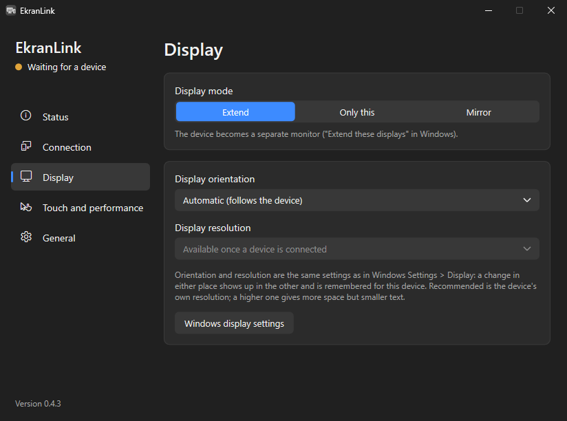
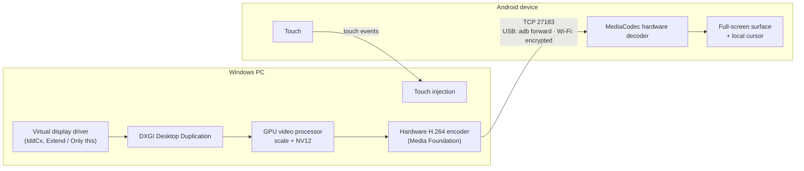

<p align="center">
  
</p>

<h1 align="center">EkranLink</h1>

<p align="center">
  <b>Use your Android tablet or phone as a monitor for your Windows PC — over USB or Wi-Fi.</b><br>
  Extend your desktop, make the device the PC's only screen, or mirror. Free and open source.
</p>

<p align="center">
  <b>English</b> · <a href="README.tr.md">Türkçe</a>
</p>

<p align="center">
  <a href="https://github.com/meg55/EkranLink/actions/workflows/derle.yml"></a>
  <a href="LICENSE"></a>
  
  
</p>

<p align="center">
  
</p>

EkranLink turns an Android tablet or phone into a real monitor for a Windows PC. With the virtual display
driver, Windows sees an ordinary monitor at the device's native resolution: you can drag windows onto it,
rotate it and set its resolution in Windows Settings. Touch on the device works like a Windows touch
screen.

It works with current tablets and phones and with devices as old as Android 4.1. No account, no
internet connection, no ads, nothing to configure on most setups.

## Features

- **Three display modes:** *Extend* (a separate monitor), *Only this* (the device becomes the PC's only
  screen and the other monitors turn off while it is connected, handy for a headless mini PC) and *Mirror*.
- **USB or Wi-Fi.** Devices are found automatically. Wi-Fi traffic is encrypted (ECDH P-256 +
  ChaCha20-Poly1305); the first Wi-Fi connection is confirmed with the same 6-digit code on both screens.
- **Touch:** real Windows multi-touch (up to 10 fingers: scroll, pinch to zoom, press and hold for right
  click, touch keyboard) or a simple mouse mode.
- **Several devices at once,** each as its own monitor. Connect or disconnect each one from the window or
  the tray menu.
- **Follows the device:** turn the tablet upright and the Windows monitor turns portrait. Resolution and
  orientation are remembered per device.
- **Sign-in screen:** optionally runs as a Windows service, so the lock screen, sign-in screen and UAC
  prompts appear on the device too.
- **Light on the system:** the picture never leaves the GPU on the PC (capture, scaling, hardware H.264
  encoding); nothing is sent while the screen is still; the mouse cursor is drawn on the device. Idle CPU use is
  practically zero.
- **Low latency:** about 20–40 ms from PC to screen over USB, measured on a 2013 tablet
  ([measurements](docs/ROADMAP.md)).
- **Bilingual:** English and Turkish user interface.

## Status

| | |
|---|---|
| Mirror, extend, only-this-screen, USB, Wi-Fi, touch, several devices, service mode | Working |
| Windows installer and portable zip | Working; first public release in preparation |
| Virtual display driver (needed for *Extend* and *Only this*) | Working, but **not yet code-signed** for distribution: for now it can only be installed by building it yourself ([driver/](driver/README.md)). Without the driver, EkranLink mirrors. |
| Android app on Google Play | Planned; meanwhile the APK is a separate download |
| macOS, Linux, iPad | Not yet |

The plan and measurements are in [docs/ROADMAP.md](docs/ROADMAP.md); tested devices in [docs/DEVICES.md](docs/DEVICES.md).

## Getting started

1. **PC:** download `EkranLink-<version>-windows-setup.exe` from [Releases](https://github.com/meg55/EkranLink/releases)
   and install it. To try it without installing, unzip `EkranLink-<version>-windows.zip` and run `EkranLink.exe`.
   A settings window opens and an icon appears next to the clock.
2. **Device:** install `EkranLink-<version>-android.apk` on the tablet or phone (open the download on the
   device, or copy it over USB and open it with a file manager). The PC never installs apps on the device.
   For USB, turn on *Developer options > USB debugging* on the device.
3. **Connect:** open EkranLink on the device. Plug in the USB cable, or join the same Wi-Fi network as the PC.
   The PC finds the device by itself (USB first). On the first Wi-Fi connection, confirm the 6-digit code
   on both screens.

Three-finger tap on the device shows or hides the performance overlay.

## Using EkranLink

**Display modes** (*Display* page): *Extend*, *Only this* (other monitors turn off while the device is
connected and come back when it leaves) and *Mirror*. When Windows turns the screens off, the device
screen goes dark too.

**Orientation and resolution** (*Display* page): with *Automatic*, turning the device upright turns the
Windows monitor portrait (auto-rotate must be on on the device). The resolution list is the same as in
Windows Settings > Display, with the device's own resolution marked *(Recommended)*. Changes made in
either place show up in the other and are remembered per device.

**Connecting automatically:** *Connection > Connect automatically when a device is found* on the PC and
*Open automatically when plugged into a computer* on the device's welcome screen. With both on, plugging
in the device is enough. Otherwise click *Connect* in the *Status* page list, or open EkranLink on the device.

**Several devices:** each connected device has a *Disconnect* button on the *Status* page; devices that
were found but are not connected have *Connect* (also in the tray's right-click menu). A device you
disconnect is not reconnected automatically until you connect it again or unplug it.

**In the background:** you can switch to another app on the device; the Windows monitor stays, and the
picture resumes when you come back. To disconnect from the device, use the notification or the
three-finger overlay.

**Headless mini PC:** *General > Start before sign-in* (asks for administrator permission once). EkranLink
then runs as a Windows service from boot; the lock and sign-in screens appear on the device (swipe up on
the lock screen). Windows shows the lock screen only on the main monitor.

Settings apply without dropping the connection: touch, performance, auto-connect, orientation, resolution
and *Extend ↔ Only this* apply instantly; *Mirror ↔ Extend* rebuilds the picture while the device stays
connected.

**Language:** *General > Language* on the PC (System / Türkçe / English); the device uses its own language.

## FAQ

**Does it only work with old tablets?** No. It works with current Android tablets and phones; support for
devices back to Android 4.1 is a bonus, not a requirement.

**Does it need the internet or an account?** No. Everything stays between your PC and your device. Over
Wi-Fi both must be on the same local network.

**Why Android 4.1?** That is when Android got the hardware video decoder API (MediaCodec) that EkranLink
uses. The app is written without AndroidX so it keeps working there.

**Is Wi-Fi safe?** Each Wi-Fi connection uses fresh ECDH keys and authenticated encryption, and a new PC
must be approved on the device with a 6-digit code. USB connections are local and not encrypted. See
[docs/PROTOCOL.md](docs/PROTOCOL.md) and [SECURITY.md](SECURITY.md).

**Can I use an iPad or a Mac?** Not yet. A Windows PC and an Android device are required for now.

## How it works



The PC always opens the connection (USB through `adb forward`, Wi-Fi directly to the device), so the
same code path works on Android 4.x, which has no `adb reverse`. Details: [docs/ARCHITECTURE.md](docs/ARCHITECTURE.md)
and the wire protocol in [docs/PROTOCOL.md](docs/PROTOCOL.md).

## Building from source

Requirements: JDK 17+ and the Android SDK (Android Studio includes both), MinGW-w64 GCC + CMake + Ninja
(`winget install BrechtSanders.WinLibs.POSIX.MSVCRT`), Inno Setup 6 for the installer. Visual Studio is not
needed except for the driver (MSVC + WDK, see [driver/README.md](driver/README.md)).

```powershell
.\tools\paketle.ps1                         # builds everything, runs tests, writes dist\ (setup, zip, apk)
.\host-windows\build.ps1                    # Windows side only
.\host-windows\build\ekranlink-host.exe     # console version with per-second stats (--usb / --wifi / --ip)
.\host-windows\build\ekranlink-test.exe     # encryption test vectors (RFC 8439)
```

Every push is built by [GitHub Actions](.github/workflows/derle.yml).

## Repository layout

```
android/        Android app (Java, minSdk 16, no AndroidX)
host-windows/   Windows app (C++20, MinGW): tray app + settings window, Windows service, console tool, installer
driver/         Virtual display driver (IddCx, based on SudoVDA; MSVC + WDK; separately licensed)
docs/           Architecture, wire protocol, roadmap and measurements, device list
tools/          Packaging, icon generation and measurement scripts
art/            Logo, store graphics, screenshots
```

Every document is available in English and Turkish (`X.md` / `X.tr.md`). Source comments and log lines are
in Turkish; a glossary of the Turkish names used in code is in [AGENTS.md](AGENTS.md).

## Contributing

Bug reports, device test results and pull requests are welcome, in English or Turkish. See
[CONTRIBUTING.md](CONTRIBUTING.md). Please report security issues privately as described in
[SECURITY.md](SECURITY.md). If you use an AI coding assistant, point it to [AGENTS.md](AGENTS.md).

## License

EkranLink is licensed under [GPL-3.0](LICENSE). The virtual display driver in [driver/](driver/) is a
separate program, licensed under MS-PL / MIT ([driver/LICENSE](driver/LICENSE)).
