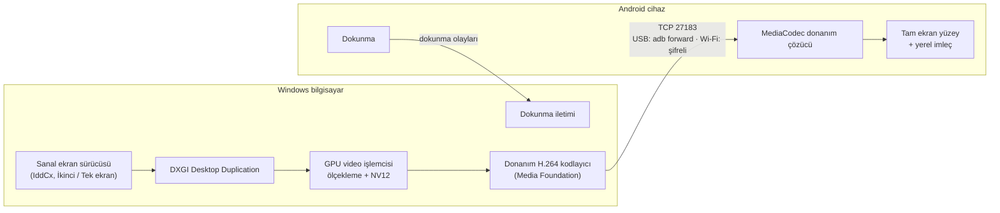

<p align="center">
  
</p>

<h1 align="center">EkranLink</h1>

<p align="center">
  <b>Android tabletinizi ya da telefonunuzu Windows bilgisayarınızın ekranı yapın — USB ya da Wi-Fi ile.</b><br>
  Masaüstünü genişletin, cihazı bilgisayarın tek ekranı yapın ya da yansıtın. Ücretsiz ve açık kaynak.
</p>

<p align="center">
  <a href="README.md">English</a> · <b>Türkçe</b>
</p>

<p align="center">
  <a href="https://github.com/meg55/EkranLink/actions/workflows/derle.yml"></a>
  <a href="LICENSE"></a>
  
  
</p>

<p align="center">
  
</p>

EkranLink, Android tablet ya da telefonu Windows bilgisayar için gerçek bir monitöre dönüştürür. Sanal ekran
sürücüsüyle Windows cihazı, kendi çözünürlüğünde sıradan bir monitör olarak görür: pencereleri üzerine
sürükleyebilir, Windows Ayarlar'dan döndürebilir ve çözünürlüğünü değiştirebilirsiniz. Cihazdaki dokunma,
Windows dokunmatik ekranı gibi çalışır.

Güncel tablet ve telefonlarla da, Android 4.1'e kadar uzanan cihazlarla da çalışır. Hesap, internet
bağlantısı ve reklam yok; çoğu durumda ayar da gerekmez.

## Özellikler

- **Üç görüntü modu:** *İkinci ekran* (ayrı bir monitör), *Tek ekran* (cihaz bağlıyken diğer monitörler
  kapanır, cihaz bilgisayarın tek ekranı olur; ekransız mini PC'ler için) ve *Yansıtma*.
- **USB ya da Wi-Fi.** Cihazlar kendiliğinden bulunur. Wi-Fi trafiği şifrelidir (ECDH P-256 +
  ChaCha20-Poly1305); ilk Wi-Fi bağlantısı iki ekranda görünen aynı 6 haneli kodla onaylanır.
- **Dokunma:** gerçek Windows çoklu dokunması (10 parmağa kadar: kaydırma, iki parmakla yakınlaştırma,
  basılı tutunca sağ tık, dokunmatik klavye) ya da basit fare modu.
- **Birden çok cihaz aynı anda,** her biri ayrı bir monitör. Her birini pencereden ya da simge menüsünden
  bağlayıp bağlantısını kesebilirsiniz.
- **Cihazı izler:** tableti dik çevirince Windows'taki monitör de dikey olur. Çözünürlük ve yön cihaz başına
  hatırlanır.
- **Oturum açma ekranı:** isteğe bağlı olarak Windows hizmeti olarak çalışır; kilit ekranı, oturum açma
  ekranı ve UAC pencereleri de cihazda görünür.
- **Sistemi yormaz:** görüntü bilgisayarda GPU'dan hiç çıkmaz (yakalama, ölçekleme, donanım H.264
  kodlama); ekran değişmiyorsa hiçbir şey gönderilmez; fare imleci cihazda çizilir. Boştayken işlemci
  kullanımı neredeyse sıfırdır.
- **Düşük gecikme:** USB'de bilgisayardan ekrana yaklaşık 20–40 ms; 2013 model bir tablette ölçüldü
  ([ölçümler](docs/ROADMAP.tr.md)).
- **İki dil:** Türkçe ve İngilizce arayüz.

## Durum

| | |
|---|---|
| Yansıtma, ikinci ekran, tek ekran, USB, Wi-Fi, dokunma, birden çok cihaz, hizmet modu | Çalışıyor |
| Windows kurulum programı ve taşınabilir zip | Çalışıyor; ilk herkese açık sürüm hazırlanıyor |
| Sanal ekran sürücüsü (*İkinci ekran* ve *Tek ekran* için gerekli) | Çalışıyor, ama dağıtım için **henüz imzalı değil**: şimdilik yalnızca kendiniz derleyerek kurulabiliyor ([driver/](driver/README.tr.md)). Sürücü yoksa EkranLink yansıtır. |
| Google Play'de Android uygulaması | Planlandı; o zamana kadar APK ayrı indirilir |
| macOS, Linux, iPad | Henüz yok |

Plan ve ölçümler: [docs/ROADMAP.tr.md](docs/ROADMAP.tr.md) · Test edilen cihazlar: [docs/DEVICES.md](docs/DEVICES.md)

## Başlarken

1. **Bilgisayar:** [Sürümler](https://github.com/meg55/EkranLink/releases) sayfasından
   `EkranLink-<sürüm>-windows-setup.exe`'yi indirip kurun. Kurmadan denemek için
   `EkranLink-<sürüm>-windows.zip`'i açıp `EkranLink.exe`'yi çalıştırın. Ayar penceresi açılır ve saatin
   yanında bir simge belirir.
2. **Cihaz:** `EkranLink-<sürüm>-android.apk` dosyasını tablete ya da telefona kurun (cihazda indirip açın
   ya da USB ile kopyalayıp dosya yöneticisinden açın). Bilgisayar cihaza uygulama kurmaz. USB için
   cihazda *Geliştirici seçenekleri > USB hata ayıklama* açık olmalı.
3. **Bağlanın:** cihazda EkranLink'i açın. USB kablosunu takın ya da bilgisayarla aynı Wi-Fi ağına bağlanın.
   Bilgisayar cihazı kendiliğinden bulur (önce USB). İlk Wi-Fi bağlantısında iki ekranda görünen 6 haneli
   kodu onaylayın.

Cihazda üç parmakla dokunmak ölçüm kartını gösterir ya da gizler.

## Kullanım

**Görüntü modları** (*Görüntü* sayfası): *İkinci ekran*, *Tek ekran* (cihaz bağlıyken diğer monitörler
kapanır, cihaz ayrılınca geri gelir) ve *Yansıtma*. Windows ekranı kapatınca cihazın ekranı da kararır.

**Yön ve çözünürlük** (*Görüntü* sayfası): *Otomatik*te cihazı dik çevirmek Windows'taki monitörü de dikey
yapar (cihazda *Otomatik döndür* açık olmalı). Çözünürlük listesi Windows Ayarlar > Ekran'daki listenin
aynısıdır; cihazın kendi çözünürlüğü *(Önerilen)* diye işaretlidir. İki yerden birinde yapılan değişiklik
diğerinde de görünür ve cihaz başına hatırlanır.

**Otomatik bağlanma:** bilgisayarda *Bağlantı > Cihaz bulununca otomatik bağlan*, cihazın karşılama
ekranında *Bilgisayara takılınca otomatik aç*. İkisi de açıksa cihazı takmanız yeterli; değilse *Durum*
sayfasındaki listeden *Bağlan*'a tıklayın ya da cihazda EkranLink'i açın.

**Birden çok cihaz:** *Durum* sayfasında bağlı her cihazın *Bağlantıyı kes* düğmesi, bulunan ama bağlı
olmayan cihazların *Bağlan* düğmesi vardır (simgenin sağ tık menüsünde de). Bağlantısını kestiğiniz cihaza,
siz yeniden bağlanana ya da cihazı çıkarana kadar otomatik bağlanılmaz.

**Arka plan:** cihazda başka bir uygulamaya geçebilirsiniz; Windows'taki monitör kopmaz, dönünce görüntü
kaldığı yerden sürer. Cihazdan bağlantıyı kesmek için bildirimi ya da üç parmakla açılan ölçüm kartını
kullanın.

**Ekransız mini PC:** *Genel > Oturum açılmadan önce başlat* (bir kez yönetici izni ister). EkranLink
açılışta Windows hizmeti olarak başlar; kilit ve oturum açma ekranları cihazda görünür (kilit perdesini
yukarı kaydırın). Windows kilit ekranını yalnızca ana monitörde gösterir.

Ayarlar bağlantıyı koparmadan uygulanır: dokunma, performans, otomatik bağlanma, yön, çözünürlük ve
*İkinci ekran ↔ Tek ekran* anında; *Yansıtma ↔ İkinci ekran* geçişinde görüntü yeniden kurulur, cihaz bağlı
kalır.

**Dil:** bilgisayarda *Genel > Dil* (Sistem / Türkçe / English); cihaz kendi dilini kullanır.

## Sık sorulanlar

**Yalnızca eski tabletlerle mi çalışır?** Hayır. Güncel Android tablet ve telefonlarla çalışır; Android
4.1'e kadar uzanan destek bir artı, şart değil.

**İnternet ya da hesap gerekir mi?** Hayır. Her şey bilgisayarınızla cihazınız arasında kalır. Wi-Fi'de
ikisi aynı yerel ağda olmalı.

**Neden Android 4.1?** EkranLink'in kullandığı donanım video çözücü arayüzü (MediaCodec) Android'e o
sürümde geldi. Orada çalışmaya devam etsin diye uygulama AndroidX kullanmadan yazıldı.

**Wi-Fi güvenli mi?** Her Wi-Fi bağlantısı yeni ECDH anahtarları ve doğrulamalı şifreleme kullanır; yeni
bir bilgisayar cihazda 6 haneli kodla onaylanmalıdır. USB bağlantıları yereldir ve şifrelenmez. Bkz.
[docs/PROTOCOL.tr.md](docs/PROTOCOL.tr.md) ve [SECURITY.md](SECURITY.md).

**iPad ya da Mac ile kullanabilir miyim?** Henüz değil. Şimdilik Windows bilgisayar ve Android cihaz gerekir.

## Nasıl çalışır



Bağlantıyı her zaman bilgisayar açar (USB'de `adb forward` üzerinden, Wi-Fi'de doğrudan cihaza); böylece
`adb reverse` olmayan Android 4.x'te de aynı yol çalışır. Ayrıntılar: [docs/ARCHITECTURE.tr.md](docs/ARCHITECTURE.tr.md)
ve iletişim protokolü [docs/PROTOCOL.tr.md](docs/PROTOCOL.tr.md).

## Kaynaktan derlemek

Gerekenler: JDK 17+ ve Android SDK (Android Studio ile gelir), MinGW-w64 GCC + CMake + Ninja
(`winget install BrechtSanders.WinLibs.POSIX.MSVCRT`), kurulum programı için Inno Setup 6. Sürücü dışında
Visual Studio gerekmez (sürücü: MSVC + WDK, bkz. [driver/README.tr.md](driver/README.tr.md)).

```powershell
.\tools\paketle.ps1                         # her şeyi derler, testleri çalıştırır, dist\'e yazar (kurulum, zip, apk)
.\host-windows\build.ps1                    # yalnızca Windows tarafı
.\host-windows\build\ekranlink-host.exe     # konsol sürümü, saniyelik ölçümlerle (--usb / --wifi / --ip)
.\host-windows\build\ekranlink-test.exe     # şifreleme test vektörleri (RFC 8439)
```

Her yükleme [GitHub Actions](.github/workflows/derle.yml) ile derlenir. Tanı için ham akış testi:
`.\tools\faz0.ps1` (ffmpeg gerekir).

## Depo yapısı

```
android/        Android uygulaması (Java, minSdk 16, AndroidX yok)
host-windows/   Windows uygulaması (C++20, MinGW): simge + ayar penceresi, Windows hizmeti, konsol aracı, kurulum
driver/         Sanal ekran sürücüsü (IddCx, SudoVDA tabanlı; MSVC + WDK; ayrı lisans)
docs/           Mimari, iletişim protokolü, yol haritası ve ölçümler, cihaz listesi
tools/          Paketleme, simge üretimi ve ölçüm betikleri
art/            Logo, mağaza görselleri, ekran görüntüleri
```

Her belgenin Türkçesi ve İngilizcesi var (`X.tr.md` / `X.md`). Kaynak koddaki yorumlar ve günlük satırları
Türkçe; kullanıcıya görünen metinler Türkçe ve İngilizce.

## Katkı

Hata bildirimleri, cihaz test sonuçları ve pull request'ler Türkçe ya da İngilizce olarak memnuniyetle
karşılanır: [CONTRIBUTING.md](CONTRIBUTING.md). Güvenlik açıklarını [SECURITY.md](SECURITY.md)'deki gibi
gizli bildirin. Yapay zekâ kodlama asistanı kullanıyorsanız ona [AGENTS.md](AGENTS.md)'yi gösterin.

## Lisans

EkranLink [GPL-3.0](LICENSE) ile lisanslıdır. Sanal ekran sürücüsü ([driver/](driver/)) ayrı bir programdır;
MS-PL / MIT ile lisanslıdır ([driver/LICENSE](driver/LICENSE)).
