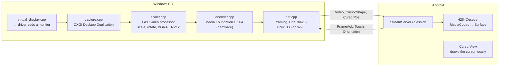
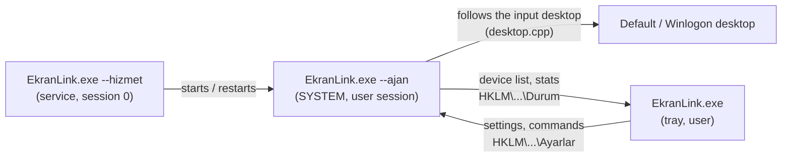

**English** · [Türkçe](ARCHITECTURE.tr.md)

# EkranLink architecture

This document explains how EkranLink is put together: the programs, how a frame travels from the PC to the
device, how devices are found and connected, and why the design looks the way it does. The wire format is
specified in [PROTOCOL.md](PROTOCOL.md); plans and measurements are in [ROADMAP.md](ROADMAP.md).
Turkish names that appear in code are explained in the glossary in [../AGENTS.md](../AGENTS.md).

## Programs

| Program | Source | Role |
|---|---|---|
| `EkranLink.exe` | `host-windows/src/tray.cpp`, `ui.cpp`, `service.cpp` | Windows app. The same executable has several roles, chosen by its first argument (below). |
| `ekranlink-host.exe` | `host-windows/src/main.cpp` | Console version for diagnostics: same streaming core, per-second stats, command-line options. |
| `ekranlink-surucu.exe` | `host-windows/src/driver_tool.cpp` | Creates / removes the virtual display's root device (`kur`, `kaldir`, `durum`). Administrator only. |
| `ekranlink-test.exe` | `host-windows/tests/crypto_test.cpp` | Encryption test vectors (RFC 8439, CNG). Runs in packaging and CI. |
| `EkranLinkVD.dll` | `driver/src/Driver.cpp` | Virtual display driver (IddCx, user-mode UMDF 2). Separate program, separate license. |
| Android app | `android/app/src/main/java/org/ekranlink/android/` | Receives and shows the picture, sends touch and orientation. |

`ekran_core` (static library, `host-windows/CMakeLists.txt`) holds everything shared by the Windows
programs: capture, scaling, encoding, networking, crypto, discovery, adb, the virtual display client,
touch injection and the `Streamer` that ties them together.

### Roles of `EkranLink.exe`

| Argument | Runs as | What it does |
|---|---|---|
| *(none)* | user | Tray icon + settings window; streams itself unless the service is installed |
| `--arka-plan` | user | Same, but without opening the window (used by the Windows startup entry) |
| `--hizmet` | SYSTEM, session 0 | Windows service: starts the agent in the active console session, restarts it, follows session changes |
| `--ajan` | SYSTEM, user session | Agent: does the streaming in service mode, including on the Winlogon desktop (lock, sign-in, UAC) |
| `--hizmet-kur` / `--hizmet-kaldir` | administrator | Install / remove the service ("Start before sign-in") |
| `--windows-ile-baslat` | user | Writes the Windows startup entry for the current user (used by the installer) |

In service mode the tray app is only a user interface: settings go to `HKLM\SOFTWARE\EkranLink\Ayarlar`,
the agent publishes state in `...\Durum`, and the tray sends commands (connect / disconnect a device)
through the `Komut` + `KomutNo` values. Without the service, the tray app streams itself and keeps settings
in `HKCU\Software\EkranLink`. Pairing secrets are in `HKCU\...\Pairs` or `HKLM\...\Gizli` (SYSTEM only).
See `host-windows/src/config.h` and `service.h`.

## Frame path

1. **Monitor.** In *Extend* / *Only this* mode `virtual_display.cpp` asks the driver (IOCTL) to add a monitor
   with the device's resolution, physical size and a GUID derived from the device ID, so Windows remembers
   placement and scaling per device. In *Mirror* mode an existing monitor is captured instead.
2. **Capture.** DXGI Desktop Duplication; the image stays in GPU memory. The cursor is reported separately and
   sent as `CursorShape` / `CursorPos` messages; the device draws it, so moving the mouse costs no video.
3. **Scale and convert.** The GPU's video processor scales the image into the stream size (aspect ratio kept,
   letterboxed), rotates it for portrait monitors and converts it to NV12. No shaders, no CPU copies.
4. **Encode.** Media Foundation hardware H.264 (NVIDIA, AMD or Intel through one code path), low-latency
   settings, no B-frames.
5. **Send.** One TCP connection per device, port 27183. Frames are length-prefixed; on Wi-Fi each frame is
   encrypted and authenticated (ChaCha20-Poly1305). Over USB the video to the device is not encrypted (it
   stays on the cable); device→PC messages such as touch are always encrypted.
6. **Decode.** `MediaCodec` hardware decoder renders straight to the surface. `SpsRewriter` patches the SPS
   (`max_num_reorder_frames = 0`) because many decoders (e.g. MediaTek) otherwise hold several frames back.
7. **Acknowledge.** The device sends `FrameAck` for frames it has shown. The PC limits frames in flight by
   these acks, so latency never builds up on a slow device or network.

### Why it is cheap and fast

- **Nothing is sent while the screen is still.** When the picture changes, a few extra "pusher" frames
  (`itici kare`) follow so that decoders that hold frames release the last real one immediately.
- **Everything heavy runs on the GPU** on the PC and on the hardware decoder on the device.
- **ChaCha20 instead of AES** on Wi-Fi: on old ARM tablets without AES instructions it is about twice as
  fast in pure Java (measured in ROADMAP.md).
- **USB detection is event-driven** (`usb_watch.cpp`): no polling while no device is plugged in.
- When the Android app goes to the background, the PC stops capturing and encoding (`VideoVisible`).

## Finding and connecting devices

`Streamer` (`host-windows/src/streamer.cpp`) is shared by the tray app, the service agent and the console
tool. It scans, keeps one `Dev` record per device and runs one session thread per connected device.

- **USB:** `adb devices`, then a broadcast to the app's `AutoStartReceiver` that returns `id|name` and whether
  the app may be opened. Each device gets its own local port with `adb forward tcp:0 tcp:27183`. The PC always
  opens the TCP connection because Android 4.x has no `adb reverse`.
- **Wi-Fi:** UDP query `EKRN?` to the broadcast address of every network interface, repeated a few times,
  plus direct queries to known device addresses. The app answers only when asked (`DiscoveryResponder`).
- **Same device on USB and Wi-Fi** is shown once (matched by device ID); USB wins.
- **Handshake:** ephemeral ECDH P-256 key exchange, then keys derived with HMAC-SHA256. A new device must be
  approved once on both screens with a 6-digit code derived from the session (over USB too); the PC commits
  to its random value first, so a man in the middle cannot make the codes match. Afterwards a pairing key is
  stored on both sides and proves each side on every connection. An unpaired device found on the network
  cannot open a prompt; the user connects it with *Connect*. See PROTOCOL.md.
- **User intent:** a device the user disconnects is "held" and not reconnected automatically until the user
  connects it again or it is unplugged; a manual *Connect* is remembered for a short while.

### Several devices

Each device has its own session, encoder and (in Extend mode) its own virtual monitor. Touch from all
devices goes into one process-wide contact table (`input.cpp`), because each Windows touch injection frame
must contain every finger that is down. *Only this* mode keeps all EkranLink monitors on and turns the
others off; the first device saves the layout and the last one restores it (`virtual_display.cpp`).

## Windows service mode

The lock screen, sign-in screen and UAC prompts are drawn on a separate desktop (Winlogon) that only a
SYSTEM process can capture or inject input into. In service mode:

The agent's capture and touch threads switch to whichever desktop currently receives input.

## Android app

| Class | Responsibility |
|---|---|
| `MainActivity` | Full-screen surface, touch mapping, window orientation (Android 16+ large screens can force portrait windows; the video is then rotated with `KEY_ROTATION`) |
| `EkranService` | Foreground service that keeps the connection while the app is in the background |
| `StreamServer`, `Session` | TCP server (the PC connects), handshake, message loop |
| `H264Decoder`, `SpsParser`, `SpsRewriter`, `AnnexBReader` | Hardware decoding |
| `CursorView` | Draws the PC cursor locally |
| `InfoLayer`, `Stats` | Welcome screen, three-finger performance overlay, pairing prompt |
| `OrientationWatcher` | Reports how the device is held so Windows can rotate the monitor |
| `DiscoveryResponder` | Answers Wi-Fi discovery queries |
| `AutoStartReceiver`, `AutoStart` | Lets the PC ask over adb whether the app may open, and get the device ID |
| `Crypto`, `ChaCha20`, `Poly1305`, `PairStore` | Key exchange, encryption, stored pairings |

The app targets API 36 but runs on API 16: no AndroidX, Java 8 language level, newer APIs behind
`Build.VERSION.SDK_INT` checks.

## Virtual display driver

`driver/` is an IddCx (Indirect Display) driver running in user mode (UMDF 2), based on SudoVDA. The
Windows app talks to it with three IOCTLs (`driver/src/ekranvd-ioctl.h`): add a monitor, remove a monitor,
ping. If the app stops pinging for 3 seconds the driver removes all its monitors, so a crash never leaves an
invisible screen behind. The EDID carries the device's physical size, so Windows suggests a sensible
scaling. Distribution needs a code signature that Windows trusts; until then `driver/kur.ps1` signs it with
a local, single-use certificate on the build machine.

## Packaging and CI

- `tools/paketle.ps1` builds the Android app and the Windows programs, runs the crypto tests and writes
  `dist/`: installer (`host-windows/installer/EkranLink.iss`, Inno Setup), portable zip and APK. It checks that
  `host-windows/src/version.h` and `android/app/build.gradle` have the same version.
- `.github/workflows/derle.yml` runs the same script on every push, builds the driver, and on a `v*` tag
  creates a draft GitHub release. The APK is signed with a release key kept outside the repository.
