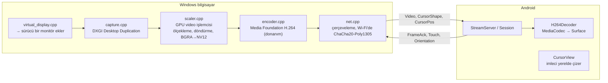
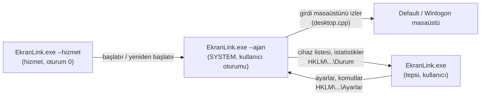

[English](ARCHITECTURE.md) · **Türkçe**

# EkranLink mimarisi

Bu belge EkranLink'in nasıl kurulduğunu anlatır: programlar, bir karenin bilgisayardan cihaza nasıl ulaştığı,
cihazların nasıl bulunup bağlandığı ve tasarımın neden bu şekilde olduğu. Kablo üzerindeki veri biçimi
[PROTOCOL.tr.md](PROTOCOL.tr.md) içinde tanımlanmıştır; planlar ve ölçümler [ROADMAP.tr.md](ROADMAP.tr.md)
içindedir. Kodda geçen Türkçe adlar [../AGENTS.md](../AGENTS.md) içindeki sözlükte açıklanır.

## Programlar

| Program | Kaynak | Görev |
|---|---|---|
| `EkranLink.exe` | `host-windows/src/tray.cpp`, `ui.cpp`, `service.cpp` | Windows uygulaması. Aynı çalıştırılabilir dosyanın birkaç rolü vardır; rol, ilk argümana göre seçilir (aşağıda). |
| `ekranlink-host.exe` | `host-windows/src/main.cpp` | Tanılama için konsol sürümü: aynı yayın çekirdeği, saniyelik istatistikler, komut satırı seçenekleri. |
| `ekranlink-surucu.exe` | `host-windows/src/driver_tool.cpp` | Sanal ekranın kök cihazını oluşturur / kaldırır (`kur`, `kaldir`, `durum`). Yalnızca yönetici. |
| `ekranlink-test.exe` | `host-windows/tests/crypto_test.cpp` | Şifreleme test vektörleri (RFC 8439, CNG). Paketleme ve CI sırasında çalışır. |
| `EkranLinkVD.dll` | `driver/src/Driver.cpp` | Sanal ekran sürücüsü (IddCx, kullanıcı modu UMDF 2). Ayrı program, ayrı lisans. |
| Android uygulaması | `android/app/src/main/java/org/ekranlink/android/` | Görüntüyü alır ve gösterir; dokunma ve yön bilgisini gönderir. |

`ekran_core` (statik kütüphane, `host-windows/CMakeLists.txt`) Windows programlarının ortak kullandığı her şeyi
içerir: yakalama, ölçekleme, kodlama, ağ, şifreleme, keşif, adb, sanal ekran istemcisi, dokunma enjeksiyonu ve
bunları birbirine bağlayan `Streamer`.

### `EkranLink.exe` rolleri

| Argüman | Çalıştığı kimlik | Ne yapar |
|---|---|---|
| *(yok)* | kullanıcı | Tepsi simgesi + ayar penceresi; hizmet kurulu değilse yayını kendisi yapar |
| `--arka-plan` | kullanıcı | Aynısı, ama pencereyi açmadan (Windows başlangıç kaydı tarafından kullanılır) |
| `--hizmet` | SYSTEM, oturum 0 | Windows hizmeti: ajanı etkin konsol oturumunda başlatır, gerektiğinde yeniden başlatır, oturum değişikliklerini izler |
| `--ajan` | SYSTEM, kullanıcı oturumu | Ajan: hizmet modunda yayını yapar; Winlogon masaüstü (kilit, oturum açma, UAC) de dahil |
| `--hizmet-kur` / `--hizmet-kaldir` | yönetici | Hizmeti kurar / kaldırır ("Oturum açılmadan önce başlat") |
| `--windows-ile-baslat` | kullanıcı | Geçerli kullanıcı için Windows başlangıç kaydını yazar (kurulum programı tarafından kullanılır) |

Hizmet modunda tepsi uygulaması yalnızca bir kullanıcı arayüzüdür: ayarlar `HKLM\SOFTWARE\EkranLink\Ayarlar`
altına yazılır, ajan durumu `...\Durum` altında yayımlar, tepsi uygulaması da komutları (bir cihaza bağlan /
bağlantıyı kes) `Komut` + `KomutNo` değerleri üzerinden gönderir. Hizmet yokken tepsi uygulaması yayını kendisi
yapar ve ayarları `HKCU\Software\EkranLink` altında tutar. Eşleştirme gizli anahtarları `HKCU\...\Pairs` ya da
`HKLM\...\Gizli` (yalnızca SYSTEM) altındadır. Bkz. `host-windows/src/config.h` ve `service.h`.

## Kare yolu

1. **Monitör.** *İkinci ekran* / *Tek ekran* modunda `virtual_display.cpp`, sürücüden (IOCTL ile) cihazın
   çözünürlüğüne ve fiziksel boyutuna sahip, cihaz kimliğinden türetilmiş bir GUID taşıyan bir monitör
   eklemesini ister; böylece Windows yerleşimi ve ölçeklemeyi her cihaz için ayrı ayrı hatırlar. *Yansıtma*
   modunda ise bunun yerine var olan bir monitör yakalanır.
2. **Yakalama.** DXGI Desktop Duplication; görüntü GPU belleğinde kalır. İmleç ayrıca bildirilir ve
   `CursorShape` / `CursorPos` mesajlarıyla gönderilir; imleci cihaz çizer, bu yüzden fareyi oynatmak hiç video
   maliyeti doğurmaz.
3. **Ölçekleme ve dönüştürme.** GPU'nun video işlemcisi görüntüyü yayın boyutuna ölçekler (en-boy oranı
   korunur, boş kalan kenarlar siyah bantla doldurulur), dikey monitörler için döndürür ve NV12'ye dönüştürür.
   Gölgelendirici (shader) yok, CPU kopyası yok.
4. **Kodlama.** Media Foundation donanımsal H.264 (NVIDIA, AMD ya da Intel, tek bir kod yolu üzerinden), düşük
   gecikme ayarları, B-kare yok.
5. **Gönderme.** Her cihaz için bir TCP bağlantısı, port 27183. Karelerin başına uzunlukları eklenir; Wi-Fi'de
   her kare şifrelenir ve doğrulanır (ChaCha20-Poly1305). USB yereldir ve şifrelenmez.
6. **Çözme.** `MediaCodec` donanım çözücüsü doğrudan yüzeye (surface) çizer. `SpsRewriter` SPS'i yamalar
   (`max_num_reorder_frames = 0`), çünkü birçok çözücü (ör. MediaTek) aksi hâlde birkaç kareyi geride tutar.
7. **Onay.** Cihaz, gösterdiği kareler için `FrameAck` gönderir. Bilgisayar, yolda olan kare sayısını bu
   onaylara göre sınırlar; böylece yavaş bir cihazda ya da ağda gecikme asla birikmez.

### Neden hafif ve hızlı

- **Ekran durağanken hiçbir şey gönderilmez.** Görüntü değiştiğinde ardından birkaç ek itici kare
  (`itici kare`) gelir; böylece kareleri bekleten çözücüler son gerçek kareyi hemen bırakır.
- **Ağır işlerin tamamı** bilgisayarda **GPU'da**, cihazda ise donanım çözücüde yapılır.
- **Wi-Fi'de AES yerine ChaCha20:** AES komutları olmayan eski ARM tabletlerde saf Java ile yaklaşık iki kat
  daha hızlıdır (ROADMAP.tr.md içinde ölçülmüştür).
- **USB algılama olay tabanlıdır** (`usb_watch.cpp`): takılı cihaz yokken yoklama (polling) yapılmaz.
- Android uygulaması arka plana geçtiğinde bilgisayar yakalamayı ve kodlamayı durdurur (`VideoVisible`).

## Cihazları bulma ve bağlama

`Streamer` (`host-windows/src/streamer.cpp`) tepsi uygulaması, hizmet ajanı ve konsol aracı tarafından ortak
kullanılır. Tarama yapar, her cihaz için bir `Dev` kaydı tutar ve bağlı her cihaz için bir oturum iş parçacığı
çalıştırır.

- **USB:** `adb devices`, ardından uygulamanın `AutoStartReceiver` bileşenine bir yayın (broadcast) gönderilir;
  bu yayın `id|name` bilgisini ve uygulamanın açılıp açılamayacağını döndürür. Her cihaz
  `adb forward tcp:0 tcp:27183` ile kendi yerel portunu alır. TCP bağlantısını her zaman bilgisayar açar, çünkü
  Android 4.x'te `adb reverse` yoktur.
- **Wi-Fi:** Her ağ arabiriminin yayın adresine birkaç kez tekrarlanan `EKRN?` UDP sorgusu, ayrıca bilinen
  cihaz adreslerine doğrudan sorgular. Uygulama yalnızca sorulduğunda yanıt verir (`DiscoveryResponder`).
- **Hem USB'de hem Wi-Fi'de görünen aynı cihaz** bir kez gösterilir (cihaz kimliğiyle eşleştirilir); USB
  öncelik kazanır.
- **El sıkışma:** geçici (ephemeral) ECDH P-256 anahtar değişimi, ardından HMAC-SHA256 ile anahtar türetme.
  Yeni bir bilgisayar, oturumdan türetilen 6 haneli bir kodla iki ekranda da onaylanmalıdır; bu, ortadaki adam
  saldırısını boşa çıkarır. Sonrasında iki tarafta da bir eşleştirme anahtarı saklanır. Bkz. PROTOCOL.tr.md.
- **Kullanıcının isteği:** kullanıcının bağlantısını kestiği bir cihaz "bekletilir"; kullanıcı onu yeniden
  bağlayana ya da cihaz çıkarılana kadar otomatik olarak yeniden bağlanmaz. Elle yapılan bir *Bağlan* işlemi
  kısa bir süre hatırlanır.

### Birden çok cihaz

Her cihazın kendi oturumu, kodlayıcısı ve (İkinci ekran modunda) kendi sanal monitörü vardır. Tüm cihazlardan
gelen dokunmalar süreç genelindeki tek bir temas tablosuna (`input.cpp`) gider, çünkü Windows'ta her dokunma
enjeksiyonu karesi o anda basılı olan tüm parmakları içermelidir. *Tek ekran* modu tüm EkranLink monitörlerini
açık tutar ve diğerlerini kapatır; ilk cihaz düzeni kaydeder, sonuncusu geri yükler (`virtual_display.cpp`).

## Windows hizmet modu

Kilit ekranı, oturum açma ekranı ve UAC istemleri ayrı bir masaüstünde (Winlogon) çizilir; bu masaüstünü
yalnızca bir SYSTEM süreci yakalayabilir ya da ona girdi gönderebilir. Hizmet modunda:

Ajanın yakalama ve dokunma iş parçacıkları, o anda girdiyi alan masaüstü hangisiyse ona geçer.

## Android uygulaması

| Sınıf | Sorumluluk |
|---|---|
| `MainActivity` | Tam ekran yüzey, dokunma eşleme, pencere yönü (Android 16+ büyük ekranlarda pencereler dikey yöne zorlanabilir; bu durumda video `KEY_ROTATION` ile döndürülür) |
| `EkranService` | Uygulama arka plandayken bağlantıyı sürdüren ön plan hizmeti |
| `StreamServer`, `Session` | TCP sunucusu (bilgisayar bağlanır), el sıkışma, mesaj döngüsü |
| `H264Decoder`, `SpsParser`, `SpsRewriter`, `AnnexBReader` | Donanımsal çözme |
| `CursorView` | Bilgisayarın imlecini yerelde çizer |
| `InfoLayer`, `Stats` | Karşılama ekranı, üç parmakla açılan performans katmanı, eşleştirme istemi |
| `OrientationWatcher` | Windows'un monitörü döndürebilmesi için cihazın nasıl tutulduğunu bildirir |
| `DiscoveryResponder` | Wi-Fi keşif sorgularını yanıtlar |
| `AutoStartReceiver`, `AutoStart` | Bilgisayarın adb üzerinden uygulamanın açılıp açılamayacağını sormasını ve cihaz kimliğini almasını sağlar |
| `Crypto`, `ChaCha20`, `Poly1305`, `PairStore` | Anahtar değişimi, şifreleme, saklanan eşleştirmeler |

Uygulama API 36'yı hedefler ama API 16'da da çalışır: AndroidX yok, Java 8 dil düzeyi, daha yeni API'ler
`Build.VERSION.SDK_INT` denetimlerinin arkasında.

## Sanal ekran sürücüsü

`driver/`, SudoVDA tabanlı, kullanıcı modunda (UMDF 2) çalışan bir IddCx (Indirect Display) sürücüsüdür.
Windows uygulaması onunla üç IOCTL üzerinden konuşur (`driver/src/ekranvd-ioctl.h`): monitör ekle, monitör
kaldır, ping. Uygulama 3 saniye boyunca ping göndermezse sürücü tüm monitörlerini kaldırır; böylece bir çökme
asla geride görünmez bir ekran bırakmaz. EDID, cihazın fiziksel boyutunu taşır; böylece Windows makul bir
ölçekleme önerir. Dağıtım için Windows'un güvendiği bir kod imzası gerekir; o zamana kadar `driver/kur.ps1`
sürücüyü derleme makinesinde yerel, tek kullanımlık bir sertifikayla imzalar.

## Paketleme ve CI

- `tools/paketle.ps1` Android uygulamasını ve Windows programlarını derler, şifreleme testlerini çalıştırır ve
  `dist/` klasörünü oluşturur: kurulum programı (`host-windows/installer/EkranLink.iss`, Inno Setup), taşınabilir
  zip ve APK. `host-windows/src/version.h` ile `android/app/build.gradle` dosyalarında aynı sürümün yazılı
  olduğunu denetler.
- `.github/workflows/derle.yml` her push'ta aynı betiği çalıştırır, sürücüyü derler ve bir `v*` etiketinde
  taslak bir GitHub sürümü (release) oluşturur. APK, deponun dışında tutulan bir yayın anahtarıyla imzalanır.
